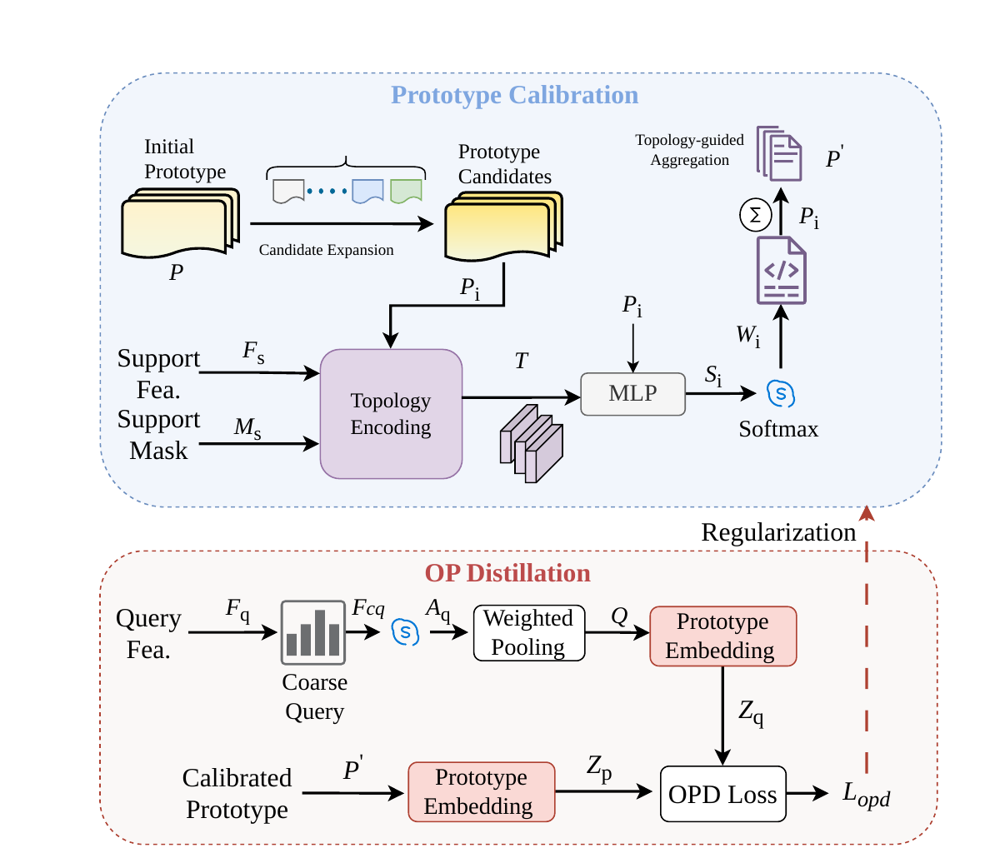

<div align="center">

# ToPo-OPD

### Topology-Calibrated Prototype Distillation for Few-shot Point Cloud Segmentation

[](#overview)
[](https://pytorch.org/)
[](#experimental-summary)
[](#citation)

Official project repository for **Topology-Calibrated Prototype Distillation for Few-shot Point Cloud Segmentation**.

</div>

> The complete implementation will be released.

## Overview

Few-shot point cloud semantic segmentation (FS-PCS) aims to recognize novel semantic categories from only a few annotated support scenes. Existing prototype-based methods remain limited by two coupled issues: masked-average support prototypes can discard local topology, while coarse query states are not explicitly aligned with the support prototype space.

**ToPo-OPD** addresses both issues through topology-guided prototype calibration and on-policy prototype distillation. ToPo improves the support representation before query matching, and OPD transfers the calibrated prototype structure to the query branch during training.

## Pipeline

<p align="center">
  
</p>

<p align="center"><em>ToPo-OPD jointly calibrates support prototypes with topology cues and regularizes on-policy query prototypes in a shared embedding space.</em></p>

### Topology-guided Prototype Calibration

ToPo expands an initial support prototype into multiple candidates and evaluates their compatibility with the masked support topology. Topology-aware weights aggregate these candidates into a calibrated prototype, reducing support-side bias while retaining structural information.

### On-policy Prototype Distillation

OPD constructs a query-side prototype from the model's current coarse activations and aligns it with the calibrated support prototype through temperature-scaled distillation. The branch is used only during training and introduces no additional inference-time path.

## Highlights

- Jointly addresses support-side prototype bias and query-side misalignment.
- Preserves structural cues through topology-aware candidate aggregation.
- Distills calibrated support knowledge into the query states visited during optimization.
- Remains compatible with standard episodic 2-way/3-way and 1-shot/5-shot protocols.
- Adds no OPD branch at inference time.

## Experimental Summary

Experiments are conducted on the S3DIS and ScanNet indoor point cloud benchmarks. The current manuscript reports the best mean IoU in seven of eight standard settings, including all four S3DIS settings and three of four ScanNet settings. Across the eight settings, ToPo-OPD improves the average mean IoU over the DPA baseline from 65.81 to 67.12.

Qualitative comparisons further show more coherent foreground regions, fewer holes, and cleaner boundaries under limited support supervision.

## Backbones and Future Experiments

The current study follows the established DGCNN-based few-shot segmentation pipeline. A Stratified Transformer backbone is also considered for stronger hierarchical point representations.

Future experiments will extend the evaluation to additional backbone families, topology neighborhood settings, prototype candidate counts, distillation temperatures, and cross-dataset generalization. Verified configurations and results will be released progressively with the complete implementation.

## Citation

Citation information will be added after the paper metadata is finalized.

## Acknowledgement

We thank the authors of [DGCNN](https://github.com/WangYueFt/dgcnn) and [Stratified Transformer](https://github.com/dvlab-research/Stratified-Transformer) for their excellent work.

## Runnable synthetic episodes and support-cloud contract

Requires Python 3.10+ and PyTorch. From the repository root:

```bash
python -m pip install torch --index-url https://download.pytorch.org/whl/cpu
python -m examples.synthetic_episode
python -m unittest discover -s tests -v
```

The example uses the actual DGCNN, ToPo and training-only OPD modules on CPU,
with forward/backward runs for 2-way/3-way × 1-shot/5-shot. It is a synthetic
structural check, **not a reproduction of S3DIS or ScanNet results**.

| Input | Legacy single cloud | Explicit support clouds |
| --- | --- | --- |
| `support_points` | `[B,Ns,D]` | `[B,S,Ns,D]` |
| `support_masks` | `[B,C,Ns]` | `[B,S,C,Ns]` |
| `query_points` | `[B,Nq,D]` | `[B,Nq,D]` |
| `logits` | `[B,Nq,C]` | `[B,Nq,C]` |

`D` starts with XYZ. `C` counts classifier channels, including background if
provided; `way` counts foreground classes. Class channels must have the same
meaning in every support cloud and in query targets. Masks are finite,
nonnegative binary or soft weights; pooling uses their mass, while topology
uses nonzero membership. Query labels are never inputs to the model.

`S` is the number of clouds, not the per-class shot count. The example allocates
`S=way*shot` distinct clouds, each with one foreground class and background.
A foreground class therefore has exactly `shot` nonempty masks. Background
uses all support clouds. Other layouts are allowed, but the caller must verify
its per-class shot counts. No padded point/ragged cloud contract is supplied.

Explicit clouds are reshaped to `[B*S,Ns,D]`, so DGCNN kNN and ToPo masked
neighborhoods stay within each cloud. Never concatenate separate scenes along
`Ns`: coincident coordinates can create cross-scene edges in both modules.
BatchNorm still shares training batch statistics; independent neighborhoods
do not imply statistically independent features in training mode.

For each cloud/class, masked pooling produces a prototype, then unchanged ToPo
calibrates it. Initial and calibrated prototypes are separately averaged with
**equal weight per nonempty cloud/class**, not proportional to foreground point
count. Empty cloud/class masks are excluded; an explicit episode with a class
missing from all clouds is rejected. Legacy empty-mask behavior is preserved.
This is an explicit, newly documented aggregation convention; it is not evidence
that the manuscript used this exact multi-shot convention. No DGCNN, ToPo or
OPD internal algorithm is changed.

Explicit inputs additionally return `shot_initial_prototypes`,
`shot_calibrated_prototypes` (`[B,S,C,F]`), `shot_candidate_prototypes`
(`[B,S,C,K,F]`), `shot_candidate_weights` (`[B,S,C,K]`) and `shot_valid`
(`[B,S,C]`). `K` is the candidate count. Invalid shot/class entries must be
ignored. Existing candidate keys retain episode-shaped outputs by averaging
valid shot candidates/weights independently; these are diagnostics, and their
product does not generally reconstruct the averaged calibrated prototype.
Use the shot-level keys to inspect the exact calibration and aggregation.

### Scope of validation

Tests cover dimensions, all four protocol combinations, finite gradients,
mask pooling, equal-shot aggregation, missing masks, malformed input, legacy
computation equivalence, shot permutation, and DGCNN/ToPo cloud isolation in
evaluation mode. A kNN regression demonstrates the cross-cloud edges introduced
by point-axis concatenation. The example is reproducibly seeded.

Real dataset episode generation, scene/block ID disjointness, base/novel splits,
checkpoint loading, training schedules and benchmark mIoU are not supplied or
validated here. A production loader must enforce these constraints from dataset
metadata; coordinate separation alone cannot establish scene disjointness.
